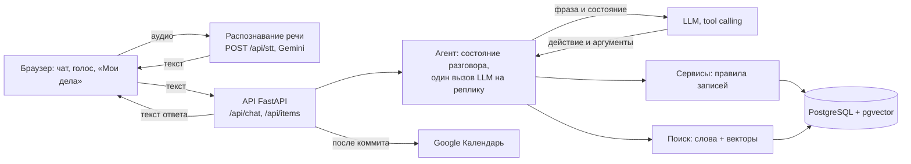

# GORKY — голосовой ассистент для задач и встреч

Говорите или пишите обычными словами — ассистент создаёт задачи, напоминания и встречи, показывает планы на период, находит старые записи по смыслу, переносит и отменяет их, а при нехватке данных переспрашивает. Прототип для хакатона «Горький код».

**Работающий прототип:** https://gorky.bond · документация API: https://gorky.bond/docs

**Статья** — архитектура, устройство агента и поиска, замер качества: [`docs/paper/gorky.pdf`](docs/paper/gorky.pdf). Кратко: агент прошёл 557 из 581 кейса (95,9 %), поиск находит нужную запись в 441 из 457 запросов (96,5 %) и ни разу не выбрал чужую запись для изменения.

**Демо-учётка с данными** (1000 записей стартового набора — на ней видны списки и поиск): логин `jury`, пароль `dpvN7gJWBK3o6JOe`. Без входа страница работает сразу, но гость начинает с пустого календаря.

---

## Как пользоваться

Нажмите микрофон и скажите фразу или напечатайте её в чат. Ассистент ответит текстом и голосом, а запись появится в панели «Мои дела».

| Фраза | Что произойдёт |
|---|---|
| «Напомни мне завтра в 10 утра позвонить Ивану» | напоминание на завтра, 10:00 |
| «В четверг в 11 у меня встреча с дизайнером» | встреча в ближайший четверг, 11:00 |
| «Поставь встречу с Иваном завтра» | вопрос «На какое время поставить встречу?»; ответ «в 15:00» — встреча создана |
| «Что запланировано на эту неделю?» | список за неделю с понедельника по воскресенье |
| «Когда у меня была встреча с Иваном?» | последняя из прошедших встреч с Иваном и её дата |
| «Я когда-то ставил задачу по договору, найди её» | записи про договор, в том числе по смыслу, без точного совпадения слов |
| «Перенеси её на пятницу» → «Отмени её» → «Верни» | перенос, отмена и откат той же записи |

Фразы — из примеров задания, ожидаемый результат по каждой — в [`docs/test-cases.md`](docs/test-cases.md). Списки и поиск по старым записям показывайте под демо-учёткой.

---

## Запуск локально

**Нужно:** Docker с Docker Compose и ключ Gemini API ([aistudio.google.com/apikey](https://aistudio.google.com/apikey); подойдёт и любой OpenAI-совместимый провайдер).

1. **Клонировать репозиторий.**
   ```bash
   git clone https://github.com/anastbezu/gorkycode-test.git
   cd gorkycode-test
   ```
2. **Создать `.env`** из образца и вписать ключ — `LLM_API_KEY` (чат) и `STT_API_KEY` (голос; можно тот же ключ):
   ```bash
   cp .env.example .env
   ```
   Остальное в образце уже заполнено для локального запуска:

   | Переменная | Значение в образце | Зачем |
   |---|---|---|
   | `POSTGRES_USER`, `POSTGRES_PASSWORD`, `POSTGRES_DB` | готовы | база в контейнере |
   | `LLM_BASE_URL`, `LLM_MODEL` | Gemini, `gemini-3.5-flash-lite` | модель агента — та, на которой сделан замер качества |
   | `STT_MODEL` | `gemini-3.5-flash-lite` | распознавание речи; без ключа микрофон отвечает «недоступно», текст работает |
   | `DEMO_ACCOUNTS` | `jury` и `denis` с примерными паролями | учётки со стартовым набором из 1000 записей |
   | `GOOGLE_*` | пусто | Google Календарь; пусто — подключение выключено |

   Пояснение к каждой переменной — в самом [`.env.example`](.env.example).
3. **Запустить.** Первая сборка долгая: ставится PyTorch (CPU) и скачивается модель поиска.
   ```bash
   docker compose up -d --build
   ```
   Миграции применяются сами при старте. Открыть **http://localhost:3000** — страница, `/api` контейнер страницы передаёт бэкенду. Проверка бэкенда: http://localhost:8000/health → `{"status": "ok", "db": "connected"}`.

Остановить — `docker compose down`; данные базы остаются в томе `postgres_data`.

**Для разработки** (страница с горячей перезагрузкой через `npm run dev`, бэкенд без Docker, тесты, бенчмарк агента, правила веток) — [`docs/dev-guide.md`](docs/dev-guide.md) и [`docs/modules/backend.md`](docs/modules/backend.md), «Локальный запуск и тесты».

---

## Архитектура



- **Браузер** (`frontend/`, React + TypeScript) — лента чата, запись голоса, озвучка ответа голосом браузера, «Мои дела», календарь, вход, кнопки записей.
- **Распознавание речи** (`backend/stt/`) — на сервере: аудио → текст через Gemini; дальше обычный текстовый запрос. Агент не знает, был это голос или клавиатура.
- **Агент** (`backend/agent/`) — ведёт реплику: загружает состояние разговора, вызывает LLM **один раз**, исполняет выбранное действие, обновляет состояние, собирает ответ по шаблону. Модель только выбирает действие и аргументы — всё остальное делает код.
- **Сервисы** (`backend/services/`) — бизнес-правила: дата не в прошлом, у встречи есть время, пересечения, дубли, откат. Ими же пользуются кнопки интерфейса без LLM.
- **Поиск** (`backend/search/`) — два уровня: «точно» по словам (основы, падежи, опечатки), иначе «похожие» по смыслу — локальная модель эмбеддингов в pgvector.
- **Хранение** (`backend/db/`, Alembic) — PostgreSQL: записи, состояние разговоров, учётки, векторы, подключения Google. Один коммит на запрос: запись и память разговора не расходятся.
- **Google Календарь** (`backend/gcal/`) — после коммита записи учётки уходят в отдельный календарь «Голосовой ассистент».

Подробно: [`docs/architecture.md`](docs/architecture.md); модули — [`docs/modules/`](docs/modules/); договорённости между модулями — [`docs/contracts/`](docs/contracts/).

### Структура репозитория

```
backend/                 Python 3.13, FastAPI
├── main.py              приложение, маршруты, прогрев модели поиска
├── api/                 HTTP: чат, записи (кнопки), голос, учётки, Google Календарь
├── agent/               агент: состояние разговора, вызов LLM, исполнение действия, ответ
├── schemas/             Pydantic-модели: действия агента, записи, API — общий контракт
├── services/            бизнес-правила записей и учёток: проверки, пересечения, дубли
├── search/              поиск: «точно» по словам, «похоже» по векторам
├── stt/                 распознавание речи (Gemini)
├── gcal/                Google Календарь
├── db/, alembic/        модели SQLAlchemy и миграции PostgreSQL
├── data/                стартовый набор из 1000 записей (CSV организаторов)
├── scripts/             загрузка набора, демо-учётки, чистка удалённых старше 30 дней
├── eval/                бенчмарк агента: наборы кейсов, прогон, метрики, отчёты
└── tests/               pytest: модули, агент на сценарии, API, база
frontend/                React + TypeScript + Vite
└── src/                 api/ — запросы и типы, components/ — экран, lib/ — запись голоса, озвучка, хранение
docs/                    архитектура, решения, контракты модулей, устройство модулей, эталонные фразы
.github/workflows/       CI (тесты, сборка образов) и деплой на стенд
docker-compose.yaml      база, бэкенд, страница
```

---

## Технологии и почему

Обоснования — из [`docs/decisions.md`](docs/decisions.md) (фронтенд — из [`docs/modules/frontend.md`](docs/modules/frontend.md), календарь — из [`docs/modules/backend.md`](docs/modules/backend.md)).

| Что | Выбрали | Почему |
|---|---|---|
| Язык и фреймворк | Python 3.13, FastAPI, Pydantic v2 | Pydantic-модели — одновременно контракт, валидация и документация API; асинхронные вызовы LLM |
| Доступ к БД | SQLAlchemy 2, Alembic, psycopg 3; один коммит на реплику | стандартный стек для FastAPI, миграции схемы; запись и состояние разговора сохраняются вместе — «верни» всегда может откатить изменение |
| База данных | PostgreSQL + pgvector | записи, векторы и полнотекстовый поиск в одной базе |
| LLM | OpenAI SDK, совместимый API, tool calling; по умолчанию Gemini | не привязываемся к одному провайдеру, проверяющий может подставить свой ключ |
| Агент | один вызов LLM на реплику: LLM выбирает действие, код исполняет | предсказуемо, меньше запросов к LLM |
| Поиск | «точно» по словам, иначе «похожие» — локальная модель `rubert-mini-frida` в pgvector | честно отвечает «не нашёл» и находит записи с искажёнными падежами; модель на сервере — без ключа, сети и лимитов |
| Распознавание речи | на сервере, Gemini, запись до 30 с | распознавание в браузере работает не во всех браузерах, а голос — главный сценарий; пользователь видит распознанный текст |
| Синтез речи | голос браузера (`speechSynthesis`) | без второго внешнего вызова и аудио в ответе; ответ и так короткий и «на слух» |
| Интерфейс | веб: чат + панель «Мои дела»; React, TypeScript, Vite | совмещение свободного диалога и списка задач; TypeScript сверяет поля с контрактом при сборке |
| Пользователи | гость без формы или учётка по логину и паролю | страница работает сразу; учётка — те же данные на любом устройстве |
| Календарь | Google Calendar API напрямую, разрешение `calendar.app.created` | нам нужны пять REST-вызовов, MCP был бы лишней прослойкой; приложение видит только свой календарь |
| Хостинг | свой VPS, Docker Compose, Nginx + Let's Encrypt; образы собирает CI | HTTPS обязателен для микрофона; сборка с torch не помещается на диск сервера |

---

## Что сделано

**Обязательное:**

| Что | Статус | Где видно |
|---|---|---|
| Создание задачи и напоминания | да | `backend/agent/actions.py`, `backend/services/records.py`; кейсы 1.1–1.3, раздел 2 [`test-cases.md`](docs/test-cases.md) |
| Создание встречи | да | те же файлы; кейсы 1.4, 1.5 |
| Список задач и встреч за период | да | `backend/agent/list_replies.py`, `list_records_for_period`; раздел 4 `test-cases.md` |
| Поиск ранее созданной записи | да | `backend/search/`, [`docs/modules/search.md`](docs/modules/search.md); раздел 5 `test-cases.md` |
| Данные сохраняются между запросами | да | PostgreSQL, [`docs/modules/backend.md`](docs/modules/backend.md) |
| Голосовой ввод и ответ | да | `backend/stt/`, `frontend/src/lib/recorder.ts`, `speech.ts` |

**Будет плюсом:**

| Что | Статус | Где видно |
|---|---|---|
| Изменение голосом | да | `backend/agent/changes.py`; раздел 7 `test-cases.md` |
| Удаление голосом | да, мягкое | «отмени» / «удали» ставит статус «отменена», «верни» возвращает; запись стирается через 30 дней |
| Отметка «выполнено» | да | `set_status`, кейс 7.6 |
| Конфликтующие встречи | да | встреча сохраняется, ответ предупреждает о пересечении; кейсы 8.5, 8.7 |
| Повторяющиеся задачи | нет | — |
| Контекст диалога («перенеси её на завтра») | да | состояние разговора: фокус, номера на экране, «верни» — [`docs/modules/agent.md`](docs/modules/agent.md) |
| Семантический поиск | да | уровень «похожие», [`docs/modules/search.md`](docs/modules/search.md) |
| Интеграция с календарём | да | Google Календарь: подключение в настройках учётки, записи уходят в отдельный календарь «Голосовой ассистент» — `backend/gcal/`, [`docs/modules/frontend.md`](docs/modules/frontend.md) |
| Несколько пользователей | да | гости и учётки, `backend/api/auth.py`, `backend/services/accounts.py` |
| Неоднозначные запросы и уточняющий диалог | да | вопрос о недостающем, выбор из нескольких, «Точно такой нет. Может…?» — раздел 3 `test-cases.md` |

Плюс: кнопки для записей без LLM (создать, перенести, выполнено, удалить с «Вернуть»), встроенный календарь, светлая и тёмная тема, вёрстка для телефона.

---

## Как проверяли качество

Бенчмарк агента — [`backend/eval/`](backend/eval/): 581 кейс в 9 наборах (747 реплик), прогон на настоящей модели (`gemini-3.5-flash-lite`) и настоящей базе. Кейс — фраза или диалог и ожидание на каждой реплике: инструмент, его поля (тип, название, даты, период, запрос, цель) и исход действия.

| Метрика | Значение |
|---|---|
| Пройдено кейсов | 557 / 581 = 95,9 % |
| Выбор инструмента, macro-F1 | 0,967 |
| Время реплики, медиана / 95-й процентиль | 1,12 с / 1,81 с |

| Набор | Что проверяет | Пройдено |
|---|---|---|
| test-cases | примеры из задания и сценарии команды | 173 / 176 |
| create | создание: тип, название, даты, срок, конец | 74 / 75 |
| list | список за период | 48 / 50 |
| search | поиск по теме и человеку | 50 / 50 |
| update | изменение: цель, новые значения | 57 / 60 |
| status | выполнено, отменено, вернуть, массовые | 44 / 50 |
| dialog | уточнение, выбор, подтверждение, отказ | 46 / 50 |
| traps | справка, посторонняя тема, две команды, отрицание | 46 / 50 |
| undo | «верни как было» | 19 / 20 |

Отчёт с графиками, матрицей ошибок выбора инструмента и разбором каждой ошибки — [`report.md`](backend/eval/reports/agent-final/report.md) и [`report.pdf`](backend/eval/reports/agent-final/report.pdf); отчёт по каждому набору — рядом. Как запустить прогон и собрать отчёт — [`backend/eval/README.md`](backend/eval/README.md).

Поиск измерен отдельно на стартовом наборе из 1000 записей: на 457 запросах с ответом нужная запись найдена в 441 (96,5 %), ни одна из 587 целей изменения не привела к действию над чужой записью — [`backend/eval/reports/search/report.md`](backend/eval/reports/search/report.md).

**Статья** с архитектурой, устройством агента и поиска и разбором замеров — [`docs/paper/gorky.pdf`](docs/paper/gorky.pdf).

Кроме того, в CI на каждый PR — тесты бэкенда (pytest на настоящем PostgreSQL, модель подменена) и фронтенда (Vitest), автотест агента по эталонным фразам [`docs/test-cases.md`](docs/test-cases.md) на сценарии вместо модели.

---

## Решения, принятые самостоятельно

1. **Один вызов LLM на реплику.** Модель только выбирает действие и аргументы; проверки, сохранение и текст ответа — код. Ответ «Готово» никогда не придумывает модель.
2. **Память разговора на сервере, а не история сообщений.** В промпт — короткая выжимка: показанные записи под номерами, фокус, черновик. «Вторую», «её», «нет, в 16», «не эту, а ту» работают без лишнего вызова модели.
3. **Отмена сразу, с откатом «верни»**, а не вопрос «Удалить?»: удаление мягкое и обратимо. Подтверждение — только при отмене нескольких записей сразу.
4. **Конфликт встреч не мешает сохранить** — ответ предупреждает.
5. **Изменяется только точно найденная запись.** Похожую ассистент лишь предлагает вопросом: лучше «не нашёл», чем изменить чужое.
6. **Один текст ответа для чата и голоса**, найденные записи — пронумерованным списком на экране: пользователь называет номер, который видит.
7. **Поиск в два уровня** с локальной моделью эмбеддингов — без ключа, сети и лимитов, честное «точно не нашёл, похожие: …».
8. **Гость без формы, датасет — только демо-учёткам:** страница работает сразу, а «создать» начинается с чистого календаря.

---

## Ограничения и масштабирование

Прототип работает на небольшом VPS без GPU, и ряд решений принят под этот лимит осознанно — с понятным путём роста.

| Сейчас | Почему | Как масштабировать |
|---|---|---|
| Модель эмбеддингов `rubert-mini-frida` (312 чисел на вектор), на CPU внутри бэкенда | быстро считается на процессоре, помещается в память сервера, работает без ключа и внешних лимитов | крупная модель (полная FRIDA или мультиязычная) на GPU отдельным сервисом эмбеддингов; векторы пересчитываются фоновой задачей, индекс HNSW в pgvector |
| Агент — один вызов LLM на реплику, по умолчанию `gemini-3.5-flash-lite` | быстрый ответ (медиана 1,1 с) и малый расход лимита ключа; замер показал 95,9 % пройденных сценариев | провайдер и модель меняются настройкой (OpenAI-совместимый API); крупная модель — для трудных реплик, лёгкая — для остальных |
| Бэкенд — один экземпляр; соединение с базой держится, пока ждём модель | хватает для демо и жюри | отпускать соединение на время вызова модели ([`docs/ideas.md`](docs/ideas.md), И-04), пул соединений (PgBouncer), несколько реплик API за Nginx — состояние разговора уже хранится в PostgreSQL, а не в памяти процесса |
| Образы собирает CI, а не сервер | сборка с PyTorch не помещается на диск сервера | без изменений: тот же образ разворачивается на любом числе машин |
| Озвучка — голос браузера | без второго внешнего вызова и аудио в ответе | нейросетевой синтез речи на сервере — одинаковый голос на всех устройствах |
| Веб-страница | работает на любом устройстве без установки, HTTPS даёт микрофон | PWA (установка на телефон, офлайн-оболочка) из того же фронтенда; затем мобильное приложение на React Native или Capacitor — переиспользуются TypeScript-типы и API; push-уведомления о напоминаниях |
| Нет логов на реплику | не успели за хакатон | строка лога на реплику: действие, время модели, токены, исход ([`docs/ideas.md`](docs/ideas.md), И-01) — основа для мониторинга под нагрузкой |

## Что улучшили бы

1. **Логи бэкенда** — строка на реплику: выбранное действие, время ответа модели, токены, исход ([`docs/ideas.md`](docs/ideas.md), И-01).
2. **Не держать соединение с базой, пока ждём модель** — сейчас 16-я одновременная реплика ждёт свободное соединение (И-04), и нагрузочный замер стенда (И-05).
3. **Отказ и несколько команд — силами модели:** действие «отказ» вместо списка фраз (И-06), все команды из одной фразы, а не первая (И-07).
4. **Даты считает код:** модель отдаёт сказанное («пятница, 15:00»), дату вычисляет протестированная функция; запрос к модели короче (И-08 — И-10).
5. **Кнопка «отменить» у последнего ответа** — откат без модели (И-13).
6. **Повторяющиеся задачи и настоящие уведомления** о напоминаниях в нужное время ([`docs/features.md`](docs/features.md), «Идеи на будущее»).
7. **События Google у нас** — сначала «только для чтения», затем двусторонняя синхронизация ([`docs/modules/backend.md`](docs/modules/backend.md), «Внешний календарь»).
8. **Нейросетевая озвучка** вместо голоса браузера — на некоторых устройствах нет русского голоса.

---

## Команда

| Кто | Роль                                                                                   |
|---|----------------------------------------------------------------------------------------|
| Илья | тимлид: задачи и планирование, подаёт заявку; агент, автотест агента, Google Календарь |
| Родион | техлид: решения и контракты; поиск                                                     |
| Давид | агент, кнопки записей, озвучка                                                         |
| Денис | бэкенд, база, учётки, распознавание речи                                               |
| Ася | фронтенд, сервер и деплой                                                              |
| Маша | продукт и дизайн: тексты ассистента, макеты, эталонные кейсы                           |

---

## Документация

- [Статья (PDF)](docs/paper/gorky.pdf) · [Архитектура](docs/architecture.md) · [Принятые решения](docs/decisions.md) · [Возможности](docs/features.md)
- [Эталонные фразы](docs/test-cases.md) · [Тексты ассистента](docs/assistant-texts.md) · [Идеи](docs/ideas.md)
- [Контракты модулей](docs/contracts/) · [Модули](docs/modules/) · [Сервер и деплой](docs/infra.md)
- [Правила работы в репозитории](docs/dev-guide.md) · [Задачи](docs/tasks/)
