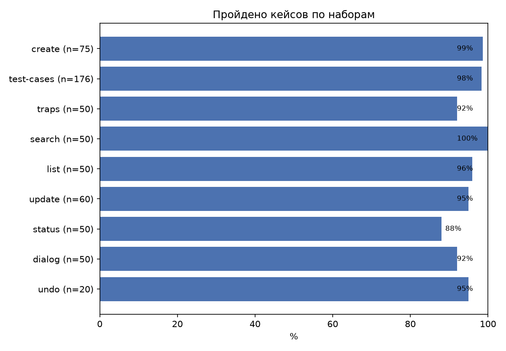
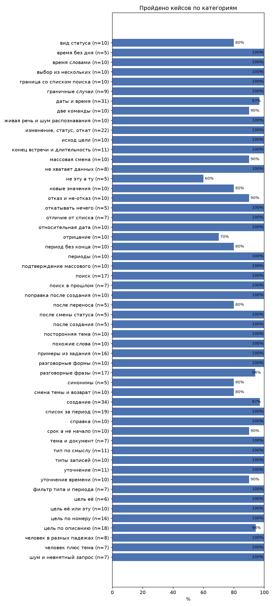
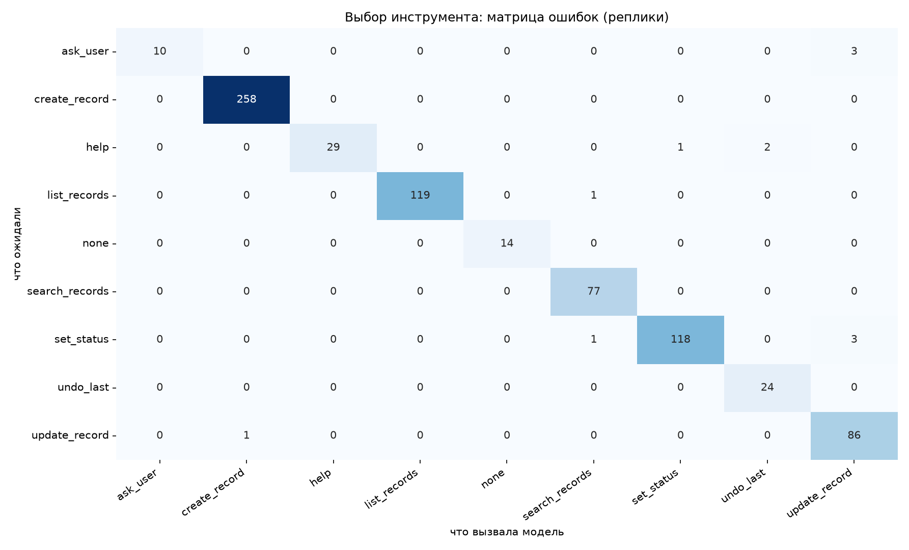
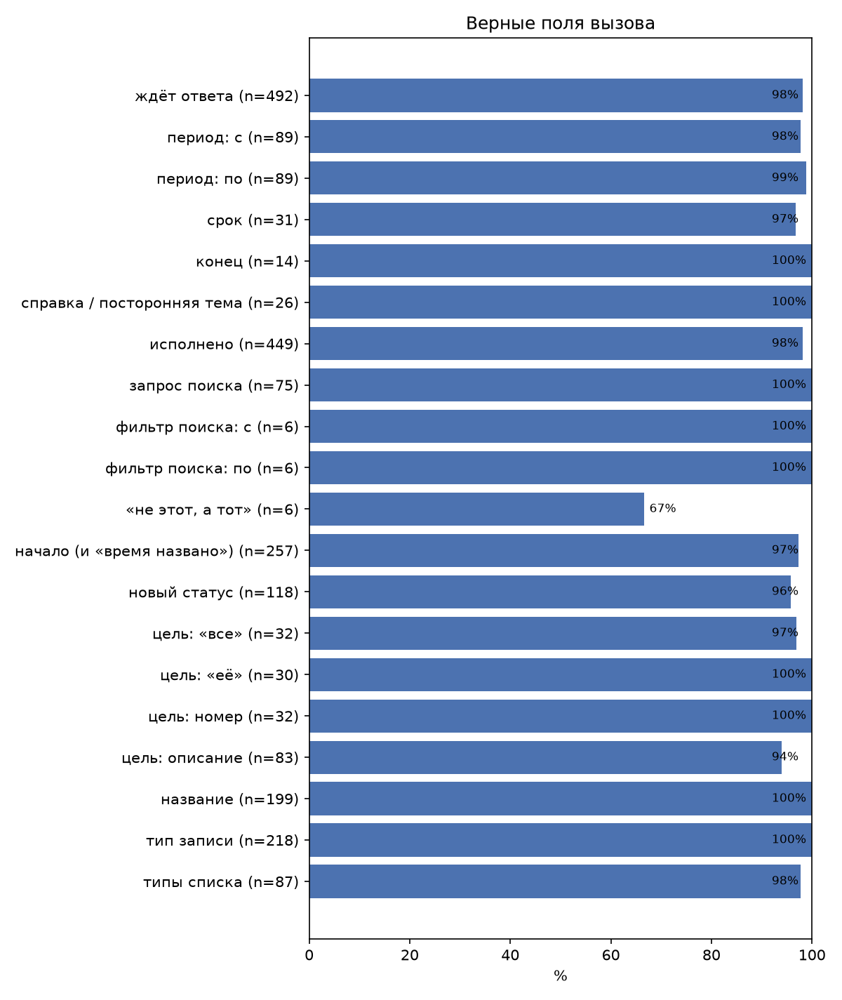

# Агент: прогон «final»

Модель агента `gemini-3.5-flash-lite`, коммит `015fc8c`. Файл прогона — `final.jsonl`. Отчёт собран 2026-10-30 09:54 UTC. Тот же отчёт с графиками — `report.pdf`.

## Итог

| Метрика | Значение |
|---|---|
| Пройдено кейсов | 557/581 = 95.9% |
| Выбор инструмента, macro-F1 | 0.967 |
| Время реплики, медиана / 95-й процентиль | 1.12 с / 1.81 с |
| Не прогонялись (проверка в интерфейсе или другим набором) | 5 |

## По наборам

| Набор | Что проверяет | Пройдено |
|---|---|---|
| [create](create.md) | создание: тип, название, начало, срок, конец, «время названо» | 74/75 = 98.7% |
| [test-cases](test-cases.md) | кейсы команды (`docs/test-cases.md`): примеры из задания и сценарии продукта | 173/176 = 98.3% |
| [traps](traps.md) | подвохи выбора инструмента: справка, посторонняя тема, две команды, отрицание | 46/50 = 92.0% |
| [search](search.md) | поиск: запрос, фильтры, отличие от списка | 50/50 = 100.0% |
| [list](list.md) | список за период: границы периода, типы записей | 48/50 = 96.0% |
| [update](update.md) | изменение: цель (номер, «её», описание), новые значения, исходы | 57/60 = 95.0% |
| [status](status.md) | выполнено / отменено / вернуть, массовые, «не эту, а ту» | 44/50 = 88.0% |
| [dialog](dialog.md) | диалог: уточнение, выбор, подтверждение, отказ, смена темы | 46/50 = 92.0% |
| [undo](undo.md) | «верни как было» после создания, переноса, смены статуса | 19/20 = 95.0% |

## По категориям

| Категория | Пройдено |
|---|---|
| вид статуса | 8/10 = 80.0% |
| время без дня | 5/5 = 100.0% |
| время словами | 10/10 = 100.0% |
| выбор из нескольких | 10/10 = 100.0% |
| граница со списком поиска | 10/10 = 100.0% |
| граничные случаи | 9/9 = 100.0% |
| даты и время | 30/31 = 96.8% |
| две команды | 9/10 = 90.0% |
| живая речь и шум распознавания | 10/10 = 100.0% |
| изменение, статус, откат | 22/22 = 100.0% |
| исход цели | 10/10 = 100.0% |
| конец встречи и длительность | 11/11 = 100.0% |
| массовая смена | 9/10 = 90.0% |
| не хватает данных | 8/8 = 100.0% |
| не эту а ту | 3/5 = 60.0% |
| новые значения | 8/10 = 80.0% |
| отказ и не-отказ | 9/10 = 90.0% |
| откатывать нечего | 5/5 = 100.0% |
| отличие от списка | 7/7 = 100.0% |
| относительная дата | 10/10 = 100.0% |
| отрицание | 7/10 = 70.0% |
| период без конца | 8/10 = 80.0% |
| периоды | 10/10 = 100.0% |
| подтверждение массового | 10/10 = 100.0% |
| поиск | 17/17 = 100.0% |
| поиск в прошлом | 7/7 = 100.0% |
| поправка после создания | 10/10 = 100.0% |
| после переноса | 4/5 = 80.0% |
| после смены статуса | 5/5 = 100.0% |
| после создания | 5/5 = 100.0% |
| посторонняя тема | 10/10 = 100.0% |
| похожие слова | 10/10 = 100.0% |
| примеры из задания | 16/16 = 100.0% |
| разговорные формы | 10/10 = 100.0% |
| разговорные фразы | 16/17 = 94.1% |
| синонимы | 4/5 = 80.0% |
| смена темы и возврат | 8/10 = 80.0% |
| создание | 33/34 = 97.1% |
| список за период | 19/19 = 100.0% |
| справка | 10/10 = 100.0% |
| срок а не начало | 9/10 = 90.0% |
| тема и документ | 7/7 = 100.0% |
| тип по смыслу | 11/11 = 100.0% |
| типы записей | 10/10 = 100.0% |
| уточнение | 11/11 = 100.0% |
| уточнение времени | 9/10 = 90.0% |
| фильтр типа и периода | 7/7 = 100.0% |
| цель её | 6/6 = 100.0% |
| цель её или эту | 10/10 = 100.0% |
| цель по номеру | 16/16 = 100.0% |
| цель по описанию | 17/18 = 94.4% |
| человек в разных падежах | 8/8 = 100.0% |
| человек плюс тема | 7/7 = 100.0% |
| шум и невнятный запрос | 7/7 = 100.0% |

## Выбор инструмента

| Инструмент | Precision | Recall | F1 | Реплик |
|---|---|---|---|---|
| `ask_user` | 1.000 | 0.769 | 0.870 | 13 |
| `create_record` | 0.996 | 1.000 | 0.998 | 258 |
| `help` | 1.000 | 0.906 | 0.951 | 32 |
| `list_records` | 1.000 | 0.992 | 0.996 | 120 |
| `none` | 1.000 | 1.000 | 1.000 | 14 |
| `search_records` | 0.975 | 1.000 | 0.987 | 77 |
| `set_status` | 0.992 | 0.967 | 0.979 | 122 |
| `undo_last` | 0.923 | 1.000 | 0.960 | 24 |
| `update_record` | 0.935 | 0.989 | 0.961 | 87 |

`none` — модель ничего не вызвала или код ответил без модели (отказ «не надо»).

## Поля вызова

| Поле | Верно |
|---|---|
| ждёт ответа | 483/492 = 98.2% |
| период: с | 87/89 = 97.8% |
| период: по | 88/89 = 98.9% |
| срок | 30/31 = 96.8% |
| конец | 14/14 = 100.0% |
| справка / посторонняя тема | 26/26 = 100.0% |
| исполнено | 441/449 = 98.2% |
| запрос поиска | 75/75 = 100.0% |
| фильтр поиска: с | 6/6 = 100.0% |
| фильтр поиска: по | 6/6 = 100.0% |
| «не этот, а тот» | 4/6 = 66.7% |
| начало (и «время названо») | 250/257 = 97.3% |
| новый статус | 113/118 = 95.8% |
| цель: «все» | 31/32 = 96.9% |
| цель: «её» | 30/30 = 100.0% |
| цель: номер | 32/32 = 100.0% |
| цель: описание | 78/83 = 94.0% |
| название | 199/199 = 100.0% |
| тип записи | 218/218 = 100.0% |
| типы списка | 85/87 = 97.7% |

Неверный инструмент — поля засчитаны неверными.

## Ошибки (24)

- **cr.31** (срок а не начало) — «Поставь задачу подготовить релиз до пятницы»
  - ожидалось: `{"action": "create_record", "type": "task", "title": ["подготов", "релиз"], "start": "none", "deadline": "2026-10-23 23:59", "ok": true, "awaiting": "none"}`
  - вызвано: `action=create_record, type=task, title=подготовить релиз, start=2026-10-21 00:00, time_given=False, deadline=2026-10-23 23:59`
  - start: ожидалось пусто, получено 2026-10-21 00:00
- **2.23ж** (создание) — «В среду в 16 планёрка по сайту»
  - ожидалось: `{"action": "create_record", "type": "meeting", "title": ["планёрк|планерк", "сайт"], "start": "2026-10-28 16:00", "ok": true, "awaiting": "none"}`
  - вызвано: `action=create_record, type=meeting, title=планёрка по сайту, start=2026-10-21 16:00, time_given=True`
  - start: ожидалось 2026-10-28 16:00, получено 2026-10-21 16:00
- **6.4** (разговорные фразы) — «слушай, а можешь напомнить про договор, ну в понедельник где-то»
  - ожидалось: `{"action": "create_record", "type": "reminder", "title": ["договор"], "start": "2026-10-26", "ok": true, "awaiting": "none"}`
  - вызвано: `action=create_record, type=reminder, title=договор, time_given=False, deadline=2026-10-26 23:59`
  - start: ожидалось 2026-10-26, получено пусто
- **9:в среду** (даты и время) — «Напомни в среду в 12 оплатить счёт»
  - ожидалось: `{"action": "create_record", "type": "reminder", "start": "2026-10-28 12:00", "ok": true, "awaiting": "none"}`
  - вызвано: `action=create_record, type=reminder, title=оплатить счёт, start=2026-10-21 12:00, time_given=True`
  - start: ожидалось 2026-10-28 12:00, получено 2026-10-21 12:00
- **tr.21** (две команды) — «Покажи что у меня завтра и перенеси первую встречу на пятницу»
  - ожидалось: `{"action": "list_records", "date_from": "2026-10-22 00:00", "date_to": "2026-10-23 00:00", "types": "all"}`
  - вызвано: `action=list_records, date_from=2026-10-22 00:00, date_to=2026-10-23 00:00, types=[<RecordType.MEETING: 'meeting'>]`
  - types: ожидалось ['meeting', 'reminder', 'task'], получено ['meeting']
- **tr.33** (отрицание) — «Не отменяй встречу с Иваном»
  - ожидалось: `{"action": "help|ask_user"}`
  - вызвано: `action=undo_last`
  - действие: ожидалось help|ask_user, получено undo_last
- **tr.38** (отрицание) — «Я передумал ставить встречу»
  - ожидалось: `{"action": "help|ask_user"}`
  - вызвано: `action=undo_last`
  - действие: ожидалось help|ask_user, получено undo_last
- **tr.39** (отрицание) — «Не надо отмечать выполненной задачу про отчёт»
  - ожидалось: `{"action": "help|ask_user"}`
  - вызвано: `action=set_status, target={'focus': False, 'text': 'задачу про отчёт', 'all': False}, status=active, replaces_last=False`
  - действие: ожидалось help|ask_user, получено set_status
- **ls.26** (период без конца) — «Что у меня есть в расписании начиная с сегодняшнего дня?»
  - ожидалось: `{"action": "list_records", "date_from": "2026-10-21 00:00", "date_to": "none", "types": "all"}`
  - вызвано: `action=list_records, date_from=2026-10-21 10:00`
  - date_from: ожидалось 2026-10-21 00:00, получено 2026-10-21 10:00
- **ls.30** (период без конца) — «Какие напоминания стоят на будущее?»
  - ожидалось: `{"action": "list_records", "date_from": "2026-10-21 00:00", "date_to": "none", "types": ["reminder"]}`
  - вызвано: `action=search_records, query=напоминания, filters={'types': [<RecordType.REMINDER: 'reminder'>], 'date_from': datetime.datetime(2026, 10, 21, 10, 0, tzinfo=TzInfo(10800)), 'status': [<RecordStatus.ACTIVE: 'active'>]}`
  - действие: ожидалось list_records, получено search_records
- **up.24** (цель по описанию) — «Напоминание про лекарства поставь на девять вечера»
  - ожидалось: `{"action": "update_record", "start": "2026-10-21 21:00", "target_text": ["лекарств"], "ok": true, "awaiting": "none"}`
  - вызвано: `action=create_record, type=reminder, title=лекарства, start=2026-10-21 21:00, time_given=True`
  - действие: ожидалось update_record, получено create_record
- **up.42** (новые значения) — «Совещание по сметам сегодня не в два, а в четыре»
  - ожидалось: `{"action": "update_record", "start": "2026-10-21 16:00", "target_text": ["совещан", "смет"], "ok": true, "awaiting": "none"}`
  - вызвано: `action=update_record, target={'focus': True, 'all': False}, start=2026-10-21 16:00, time_given=True, replaces_last=False`
  - target.text: нет текста
  - исполнение: ожидалось ok=True, получено False
- **up.47** (новые значения) — «Перенеси ревью на пятницу и назови его «Ревью релиза»»
  - ожидалось: `{"action": "update_record", "title": ["Ревью", "релиз"], "start": "2026-10-23", "target_text": ["ревью"], "ok": true, "awaiting": "none"}`
  - вызвано: `action=update_record, target={'focus': False, 'text': 'ревью', 'all': False}, title=Ревью релиза, replaces_last=False`
  - start: ожидалось 2026-10-23, получено пусто
- **st.2** (вид статуса) — «Готово, смету отправил»
  - ожидалось: `{"action": "set_status", "status": "done", "target_text": ["смет"], "ok": true, "awaiting": "none"}`
  - вызвано: `action=search_records, query=смету, filters={'types': [<RecordType.TASK: 'task'>, <RecordType.REMINDER: 'reminder'>], 'status': [<RecordStatus.ACTIVE: 'active'>]}`
  - действие: ожидалось set_status, получено search_records
- **st.7** (вид статуса) — «Нет, не сделал, верни её в активные»
  - ожидалось: `{"action": "set_status", "status": "active", "target_focus": true, "ok": true, "awaiting": "none"}`
  - вызвано: `action=set_status, target={'focus': True, 'all': False}, status=done, replaces_last=True`
  - status: ожидалось active, получено done
- **st.33** (массовая смена) — «Очисти завтрашний день»
  - ожидалось: `{"action": "set_status", "status": "cancelled", "target_all": true, "ok": false, "awaiting": "confirm"}`
  - вызвано: `action=update_record, target={'focus': False, 'filters': {'date_from': datetime.datetime(2026, 10, 22, 0, 0, tzinfo=TzInfo(10800)), 'date_to': datetime.datetime(2026, 10, 23, 0, 0, tzinfo=TzInfo(10800))}, 'all': True}, title=cancelled, replaces_last=False`
  - действие: ожидалось set_status, получено update_record
- **st.44** (не эту а ту) — «Ой, не с Ярославом, а с Ростиславом»
  - ожидалось: `{"action": "set_status", "status": "cancelled", "replaces_last": true, "target_text": ["Ростислав"], "ok": true, "awaiting": "none"}`
  - вызвано: `action=update_record, target={'focus': True, 'all': False}, title=Встреча с Ростиславом, replaces_last=True`
  - действие: ожидалось set_status, получено update_record
- **st.45** (не эту а ту) — «Нет, я Григорию позвонил, не Георгию»
  - ожидалось: `{"action": "set_status", "status": "done", "replaces_last": true, "target_text": ["Григор"], "ok": true, "awaiting": "none"}`
  - вызвано: `action=update_record, target={'focus': True, 'all': False}, title=Позвонить Григорию, replaces_last=True`
  - действие: ожидалось set_status, получено update_record
- **st.47** (синонимы) — «Закрой задачу про печать»
  - ожидалось: `{"action": "set_status", "status": "done", "target_text": ["печат"], "ok": true, "awaiting": "none"}`
  - вызвано: `action=set_status, target={'focus': False, 'text': 'печать', 'all': False}, status=done, replaces_last=False`
  - исполнение: ожидалось ok=True, получено False
- **dl.5** (уточнение времени) — «В восемь»
  - ожидалось: `{"action": "create_record", "type": "meeting", "title": ["Лик"], "start": "2026-10-22 08:00", "ok": true, "awaiting": "none"}`
  - вызвано: `action=create_record, type=meeting, title=встреча с Ликой, start=2026-10-22 20:00, time_given=True`
  - start: ожидалось 2026-10-22 08:00, получено 2026-10-22 20:00
- **dl.40** (отказ и не-отказ) — «В 15»
  - ожидалось: `{"action": "ask_user", "awaiting": "answer"}`
  - вызвано: `action=update_record, target={'focus': True, 'all': False}, start=2026-10-21 15:00, time_given=True, replaces_last=False`
  - действие: ожидалось ask_user, получено update_record
- **dl.43** (смена темы и возврат) — «в 16»
  - ожидалось: `{"action": "ask_user", "awaiting": "answer"}`
  - вызвано: `action=update_record, target={'focus': True, 'all': False}, start=2026-10-21 16:00, time_given=True, replaces_last=False`
  - действие: ожидалось ask_user, получено update_record
- **dl.49** (смена темы и возврат) — «в 16»
  - ожидалось: `{"action": "ask_user", "awaiting": "answer"}`
  - вызвано: `action=update_record, target={'focus': True, 'all': False}, start=2026-10-23 16:00, time_given=True, replaces_last=False`
  - действие: ожидалось ask_user, получено update_record
- **un.9** (после переноса) — «Срок по декларации подвинь на воскресенье»
  - ожидалось: `{"action": "update_record", "deadline": "2026-10-25", "target_text": ["декларац"], "ok": true, "awaiting": "none"}`
  - вызвано: `action=update_record, target={'focus': False, 'text': 'Срок по декларации', 'all': False}, start=2026-10-25 00:00, replaces_last=False`
  - deadline: ожидалось 2026-10-25, получено пусто
  - исполнение: ожидалось ok=True, получено False
  - ожидание ответа: ожидалось None, получено choice

## Ограничения

- Кейсы наборов, кроме `test-cases`, сгенерированы моделью Gemini 3.8 Flash (high reasoning) по контрактам репозитория (`docs/contracts/`); ожидание — то, что однозначно следует из контракта. Набор `test-cases` составлен командой.
- Один прогон, повторов 1: разброс ответов модели между прогонами не измерен.
- Измерена одна модель агента; другие модели не сравнивались.
- Проверяются вызов инструмента, его поля и исход действия на настоящей базе, а не формулировка ответа пользователю.
- Голос (распознавание и синтез речи) не измерялся: на вход агенту подаётся текст.
- Время реплики — от текста пользователя до готового ответа, с исполнением на локальной базе; без пауз, которые прогон делает между вызовами модели.
